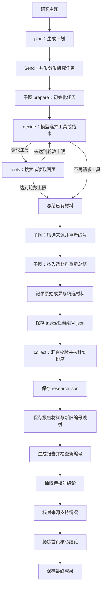

# Deep Research Agent

基于 **LangGraph、DeepSeek、Tavily、FastAPI 和 Vue 3** 的自动化研究工作流应用。

输入研究主题后，系统生成任务计划，并发研究子任务，由模型选择搜索和网页读取，再总结资料，最终生成带来源编号的研究报告。应用支持 SSE 实时进度、SQLite 检查点恢复，以及关键结论的引用证据抽查。

本项目参考 Datawhale HelloAgents 第十四章的研究场景，使用 LangGraph 组织状态、节点和执行流程，作为个人学习实践与作品集项目。

## 核心能力

| 能力 | 实现方式 |
| --- | --- |
| 研究规划 | 大模型按问题范围生成最少但充分的计划，Pydantic 验证 1～5 个子任务 |
| 联网检索 | Tavily 搜索，统一来源结构并去除重复 URL |
| 网页读取 | 提取 HTML 文本，检查正文是否为空或过短；不可用时使用搜索摘要 |
| 任务研究 | LangGraph 并行子图；模型选择搜索与网页读取，受工具轮数和每轮调用数限制 |
| 材料筛选 | 各子任务内分批筛选短片段，最多保留5条来源，重新编号并重新总结 |
| 报告生成 | 使用筛选后的材料和编号；原始研究资料单独保留 |
| 结论摘要 | 完整报告和抽样核验后凝练首页结论，详细材料说明保留在报告内 |
| 引用检查 | 检查编号是否存在，并最多抽查三条结论的来源支持情况 |
| 故障处理 | 模型 SDK 有限重试；网页读取失败降级摘要；中断后可从兼容检查点继续 |
| 后台任务 | 独立进程执行，最多2项研究并行，其余排队；SSE断开不取消研究，支持整项停止与检查点恢复 |
| 请求策略 | 各阶段分别设置读取超时，仅报告申请32K输出，其余使用服务端默认，识别服务端截断 |
| Web 交互 | 多研究切换、展示进度和报告、停止恢复、删除记录 |
| 结果保存 | 保存 JSON 研究记录、Markdown 报告和引用评估结果 |

## 技术架构

| 层次 | 技术与职责 |
| --- | --- |
| 前端 | Vue 3、JavaScript、Vite；处理输入、SSE 事件与页面状态 |
| 接口 | FastAPI；提供研究、流式研究和恢复入口 |
| 执行入口 | runner；管理研究编号、数据库连接和事件返回 |
| 工作流 | LangGraph；任务分发、并行研究、工具决策循环、结果合并与状态恢复 |
| 模型 | DeepSeek，通过 LangChain 模型客户端调用 |
| 信息获取 | Tavily、Requests、Beautiful Soup |
| 数据与持久化 | Pydantic、SQLite 检查点、JSON 和 Markdown 文件 |



SQLite 检查点用于恢复执行，JSON 和 Markdown 文件用于查看、保存研究成果，两者承担不同职责。

## 快速开始

### 环境准备

- Python **3.11 或以上**。
- 本项目开发时使用 Node.js **24** 和 npm；其他 Node.js 版本需满足所安装 Vite 的要求。
- 可用的 DeepSeek、Tavily API 密钥及相应服务额度。

以下命令从克隆后的项目根目录执行，示例使用 Conda 管理 Python 环境。

```bash
git clone https://github.com/Colofuluang/deep-research-agent.git
cd deep-research-agent
```

### 1. 安装后端依赖

```bash
conda create -n deep-research python=3.11
conda activate deep-research
python -m pip install -e .
```

### 2. 配置模型与搜索

首次配置时复制环境变量模板。如果已有自己的 `.env`，保留原配置。

```bash
cp .env.example .env
```

编辑 `.env`，填写自己的密钥：

```dotenv
DEEPSEEK_API_KEY=你的模型服务密钥
DEEPSEEK_MODEL=deepseek-flash
TAVILY_API_KEY=你的搜索服务密钥
```

模型名称按服务账号实际可访问的模型配置。真实 `.env` 已通过 `.gitignore` 排除，不应提交到仓库。

### 3. 启动后端

在项目根目录、已激活的 Python 环境中运行：

```bash
PYTHONPATH=src python -m uvicorn deep_research.api:app --reload --timeout-graceful-shutdown 5
```

- 健康检查：[http://127.0.0.1:8000/health](http://127.0.0.1:8000/health)

### 4. 启动前端

保持后端运行，另开终端，从项目根目录进入前端：

```bash
cd frontend
npm ci
npm run dev
```

浏览器打开 Vite 实际打印的 `Local` 地址，通常为 `http://localhost:5173`。

前端通过 Vite 将 `/api` 请求转发到 `http://127.0.0.1:8000`。更改后端端口时，需要同步修改 `frontend/vite.config.js`。这份代理配置用于本地开发，上传仓库不会自动部署前后端服务。

`--timeout-graceful-shutdown 5` 避免开发热重载一直等待仍连接着的SSE请求；关闭时由任务管理器结束worker并保留检查点。

## 使用方法

### 在网页中发起研究

1. 在底部输入研究主题，例如“如何为个人 Markdown 笔记构建支持来源引用的问答 Agent？”。
2. 点击发送按钮或按 Enter 开始研究；Shift + Enter 换行。
3. 在中间查看问题和执行状态，按需展开研究进度。
4. 完成后查看核心结论摘要，点击“阅读完整报告”进入 Markdown 阅读视图，再通过“返回对话”回到研究记录。旧任务没有摘要时显示报告阅读入口，不截取报告首段。

左侧显示真实后台研究记录，浏览器最多缓存20条。点击历史项不会重新执行研究；切换、刷新或关闭页面不取消后台任务，重新打开后读取服务端状态并订阅进度。可以在研究A运行时点击“新建研究”提交研究B；最多2项同时执行，其余显示排队。

输入框右下角按钮统一控制研究：空闲时显示发送箭头，运行或排队时显示圆环内实心圆，点击停止；停止后显示三角形，点击恢复。停止会终止该研究进程及全部分支，保留已成功提交的检查点；恢复使用原研究编号开启新的一次执行，未完成节点及进行到一半的请求重新执行。第三方已经收到的请求不保证能撤回。后端重启或代码热重载会中断后台进程，需要显式恢复。

侧栏记录右侧提供删除图标，悬停、键盘聚焦或选中记录时显示，触屏常驻显示。删除运行中的研究会先停止其全部分支；删除后，该研究的历次执行均从列表隐藏，网页和API不能再恢复。刷新或切换窗口会同步删除状态。当前采用逻辑删除，磁盘报告、材料和检查点仍保留；这不是永久文件清理。

当前采用对话式布局，每次发送新主题仍会发起一项独立研究，尚未提供基于已有报告的连续追问功能。

网页支持 Markdown 报告阅读，包括标题、列表、表格、引用块、链接和代码块；表格与长代码可横向滚动。报告内的原始 HTML 按文本显示，不作为页面代码执行。生成的 `report.md` 也可用 Markdown 阅读器打开。

### 恢复中断的研究

选择左侧已停止或中断的记录，点击输入框右下角三角形恢复；左下角按编号输入的恢复入口已移除。窄屏可通过左上角按钮打开研究记录侧栏。服务端打开对应的SQLite检查点，使用相同的thread_id继续未完成节点。

- 恢复时无需重新填写原主题。
- 服务重启后，只要原检查点仍在，仍可恢复。
- 已完成研究也可以通过恢复入口读取结果。
- 不同研究可以并行；同一研究编号的重复恢复会附着已有后台执行，runner文件锁额外阻止CLI与网页同时写同一检查点。
- 恢复会重新执行失败节点；网络或服务故障尚未解决时，仍可能再次失败。

### 使用命令行

也可以在项目根目录执行：

```bash
PYTHONPATH=src python -m deep_research.main
```

按提示选择 `new` 或 `resume`；`resume` 需要填写原研究编号。

CLI仍直接执行runner，不参与网页后台队列；网页停止按钮只控制其管理的后台任务。

## API 概览

| 方法 | 路径 | 用途 |
| --- | --- | --- |
| GET | `/health` | 健康检查 |
| POST | `/research/preview` | 验证主题输入，不执行研究 |
| POST | `/research/jobs` | 提交后台任务，立即返回202及job_id/run_id；可传request_id去重 |
| GET | `/research/jobs` | 近期任务状态列表，不返回报告正文 |
| GET | `/research/jobs?include_deleted=true` | 返回jobs列表和deleted_run_ids，供界面同步删除状态 |
| GET | `/research/jobs/{job_id}` | 查询状态及已完成结果 |
| GET | `/research/jobs/{job_id}/events?after=0` | SSE订阅/重放指定序号后的进度 |
| POST | `/research/jobs/{job_id}/stop` | 停止该任务全部研究分支 |
| POST | `/research/{run_id}/jobs` | 恢复检查点或附着正在执行/已完成的研究 |
| DELETE | `/research/{run_id}` | 先停止该研究，再隐藏全部执行记录；重复删除返回成功，保留磁盘文件 |
| POST | `/research` | 执行研究，完成后返回 JSON |
| POST | `/research/stream` | 新建研究，通过 SSE 返回事件 |
| POST | `/research/{run_id}/resume` | 恢复指定研究，通过 SSE 返回事件 |

新建研究示例：

```bash
curl -N -X POST http://127.0.0.1:8000/research/stream \
  -H 'Content-Type: application/json' \
  -d '{"topic":"AI Agent 的核心组成有哪些？"}'
```

SSE事件包括 `started`、`progress`、`completed`、`error` 和 `job_status`，每条有可重放的 `id`。`job_status`表示排队、运行、停止中、已停止、已中断或已删除。HTTP连接成功不代表研究完成，断开订阅也不取消任务。

## 输出文件

```text
outputs/
├── jobs.sqlite             # 后台任务状态、结果与带序号事件
├── manager.lock            # 单调度器文件锁
└── <run_id>/
    ├── run.lock            # 防止同一研究被重复执行
    ├── checkpoints.sqlite  # LangGraph 执行检查点
    ├── tasks/              # 单任务成果，以任务编号命名 JSON 文件
    ├── research.json       # 汇合后的主题、任务来源与任务总结
    ├── report_materials.json # 入选来源、重新生成的总结、新编号到原编号的映射
    ├── report.md           # 最终研究报告
    ├── summary.md          # 首页结论摘要，新流程生成；摘要失败时为空
    └── evaluation.json     # 引用证据抽查结果
```

最终报告及评估结果在对应流程完成后生成。任务中断时，可能只有检查点和已完成任务的阶段记录。

`outputs/` 默认不提交。用于展示的截图或报告应单独挑选适合公开的内容。

## 项目结构

```text
deep-research/
├── README.md
├── .env.example
├── .gitignore
├── pyproject.toml
├── src/deep_research/
│   ├── main.py          # CLI 入口
│   ├── api.py           # FastAPI 路由
│   ├── runner.py        # 会话、检查点与流式执行
│   ├── jobs.py          # 后台调度、停止恢复与删除
│   ├── job_store.py     # 任务状态、结果和事件持久化
│   ├── job_worker.py    # 独立研究进程
│   ├── graph.py         # LangGraph 工作流
│   ├── nodes.py         # 各研究节点
│   ├── state.py         # 图状态定义
│   ├── models.py        # 研究与引用数据模型
│   ├── schemas.py       # HTTP 请求与响应模型
│   ├── config.py        # 环境变量读取
│   ├── llm.py           # 模型客户端
│   ├── prompts.py       # 提示词
│   ├── citations.py     # 引用编号与来源解析
│   ├── evaluation.py    # 结论抽取与证据评估
│   ├── selection.py     # 精选来源与编号映射
│   ├── storage.py       # 研究成果保存
│   ├── events.py        # SSE 编码
│   └── tools/
│       ├── definitions.py # 可用工具定义与执行预算
│       ├── search.py    # Tavily 搜索适配
│       └── fetch.py     # 网页文本提取与基础检查
└── frontend/
    ├── package.json
    ├── package-lock.json
    ├── index.html
    ├── vite.config.js
    └── src/
        ├── main.js
        ├── App.vue
        ├── api.js
        ├── useResearch.js # 多研究状态和进度订阅
        ├── markdown.js    # 安全Markdown渲染
        └── style.css
```

## 构建与能力边界

前端构建检查：

```bash
cd frontend
npm run build
```

手动验收建议覆盖新建研究、多记录切换、停止恢复、记录删除、报告阅读，以及刷新后读取后台状态。真实研究会调用外部模型与搜索服务。

- **研究流程**：父图控制规划、并发和汇合；子图允许模型根据资料选择补搜或读取网页，不保证模型每次都能正确判断证据是否充分。
- **执行预算**：工具循环当前最多 4 轮，每轮最多执行 2 个请求；达到上限后基于已有资料总结。规划按需求生成1～5个研究分支，不为凑数扩展主题；runner 的同步图执行池额度设为6，为进度流等待任务预留一个槽，避免分支占满执行池后进度积压。
- **后台范围**：当前使用macOS/Linux的进程组和文件锁，API只运行1个调度worker；不要使用多worker启动同一输出目录。后台研究并发上限默认为2；独立进程内部仍使用现有图并发。后端重启将未完成任务标为interrupted，不自动请求模型。
- **模型请求**：`llm.py` 集中配置各阶段请求预算：常规阶段读取超时60秒、任务总结120秒、报告180秒；连接10秒、写入30秒、连接池等待10秒。SDK最多重试1次，不叠加节点重试；这些值不等于请求或整项研究的总时限。
- **输出长度**：仅报告节点设置max_tokens=32768，允许超过非思考模式默认8K输出预算；其他阶段不传输出token上限。默认显式关闭DeepSeek思考模式。提示词建议任务总结尽量1000字以内、报告正文通常不超过3500字，这些是表达指引；服务端返回finish_reason=length时仍识别为截断。摘要仍按原有失败降级逻辑处理。
- **恢复兼容**：新任务使用 workflow_version=2；没有该标记的上一版并行研究检查点使用原图恢复，保留父图筛选节点，不自动补跑摘要。更早的顺序图或固定研究子图检查点仍不保证兼容，原目录和文件不会被自动迁移。
- **网页材料**：正文检查主要判断是否为空、是否过短，不代表网页权威或与问题高度相关。
- **上下文长度**：来源文本存在截断与字符预算限制，可能遗漏后文证据。
- **筛选边界**：模型按标题、链接和最多800字符的正文或摘要片段筛选，并非全文质量认证；每批最多10条，候选过多时再做一轮筛选。筛选和重新总结增加模型调用成本，失败时不静默回退到全部原始来源。
- **报告引用**：报告与证据核对均使用 report_materials.json 的来源顺序；report_source_map 将新编号映射回 research.json 的原始编号。
- **引用评估**：最多抽查三条结论；模型只逐字选择原文，引用编号由程序从原文提取。改写原文、缺少有效引用或抽取请求失败时，保留完整报告并继续摘要；evaluation.json记录stage=extract、status=failed，表示本次抽查未完成。编号存在不等于内容支持结论；来源支持结论也不等于整篇报告或来源本身都经过事实认证。
- **结束状态**：`completed` 表示流程结束，不表示所有引用抽查都通过，需查看 `evaluation.json`。
- **摘要边界**：摘要是额外一次模型调用，失败不影响完整报告返回；首页省略材料读取说明，但保留结论本身必要的限定与不确定性。
- **运行场景**：当前面向本地学习与演示，尚未提供面向公网服务的认证、任务隔离与完整部署方案。

## 后续方向

- 扩展离线回归场景和真实研究质量评测集。
- 增加报告引用定位与更完整的来源预览交互。
- 评估模型补搜决策的有效性，并增加总 Token 和时间预算。
- 记录请求耗时与实际调用量，用可测量的数据评估改进。

## 参考与许可

- [Datawhale HelloAgents](https://github.com/datawhalechina/hello-agents)

HelloAgents 当前根目录许可为 [CC BY-NC-SA 4.0](https://github.com/datawhalechina/hello-agents/blob/main/LICENSE.txt)。直接复用的代码、文档或图片应按其实际授权处理，并保留必要署名与说明。本仓库目前尚未添加单独的 `LICENSE` 文件。
