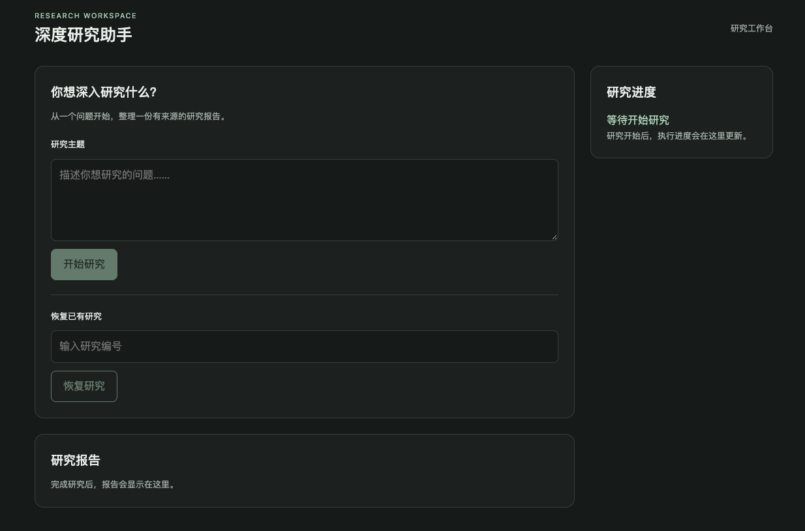
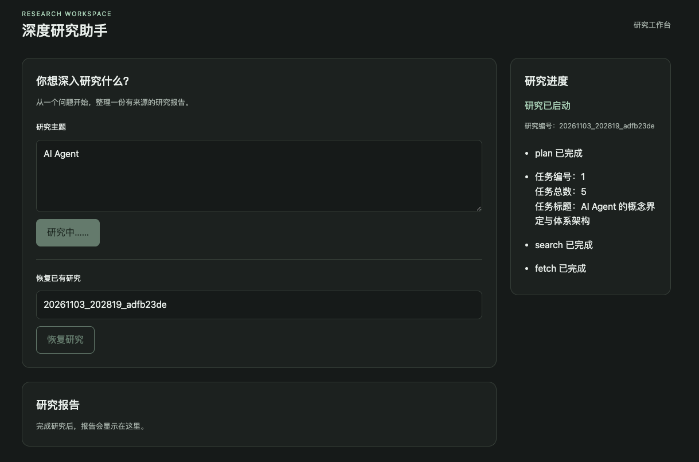
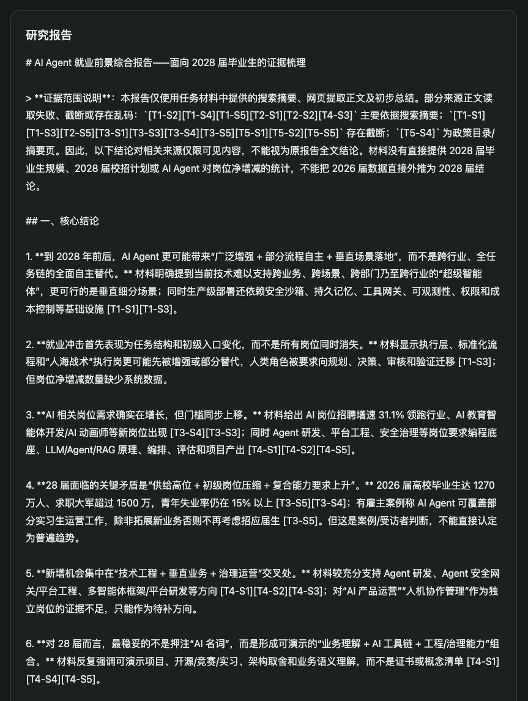
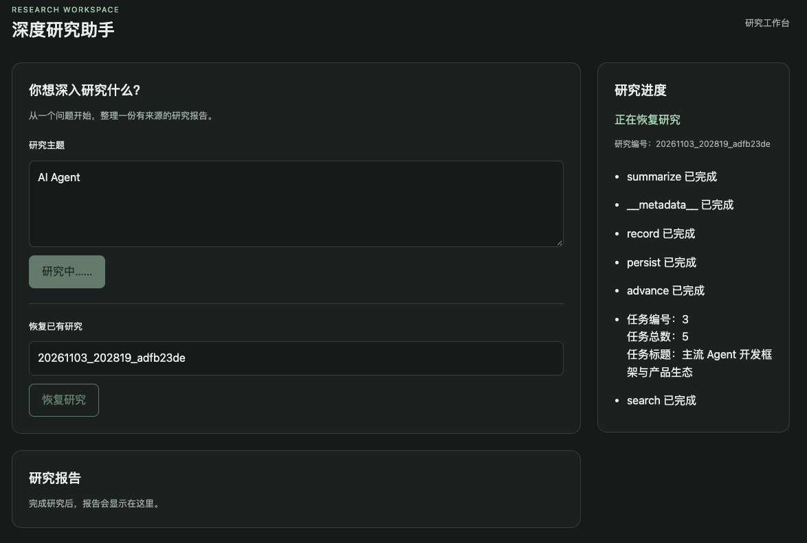
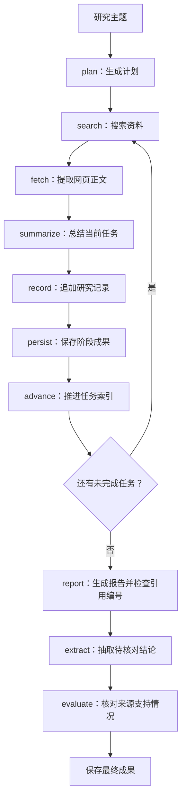

# Deep Research Agent

基于 **LangGraph、DeepSeek、Tavily、FastAPI 和 Vue 3** 的自动化研究工作流应用。

输入研究主题后，系统生成任务计划，搜索网页、提取正文并逐项总结资料，最终生成带来源编号的研究报告。应用支持 SSE 实时进度、SQLite 检查点恢复，以及关键结论的引用证据抽查。

本项目参考 Datawhale HelloAgents 第十四章的研究场景，使用 LangGraph 组织状态、节点和执行流程，作为个人学习实践与作品集项目。

## 核心能力

| 能力 | 实现方式 |
| --- | --- |
| 研究规划 | 大模型生成结构化计划，Pydantic 验证 3～5 个子任务 |
| 联网检索 | Tavily 搜索，统一来源结构并去除重复 URL |
| 网页读取 | 提取 HTML 文本，检查正文是否为空或过短；不可用时使用搜索摘要 |
| 任务研究 | 顺序执行搜索、读取、总结、记录和持久化 |
| 报告生成 | 汇总研究材料，使用 `[T1-S1]` 等编号关联来源 |
| 引用检查 | 检查编号是否存在，并最多抽查三条结论的来源支持情况 |
| 故障处理 | 搜索超时自动重试一次；中断后可从检查点继续 |
| Web 交互 | 提交主题、展示进度和报告、按研究编号恢复 |
| 结果保存 | 保存 JSON 研究记录、Markdown 报告和引用评估结果 |

## 界面演示

以下为项目实际运行截图，展示研究工作台、执行进度、最终报告与中断恢复。

### 研究工作台



<br>

### 实时研究进度



<br>

### 研究报告



<br>

### 中断与恢复



<br>

## 技术架构

| 层次 | 技术与职责 |
| --- | --- |
| 前端 | Vue 3、JavaScript、Vite；处理输入、SSE 事件与页面状态 |
| 接口 | FastAPI；提供研究、流式研究和恢复入口 |
| 执行入口 | runner；管理研究编号、数据库连接和事件返回 |
| 工作流 | LangGraph；组织节点、状态更新与任务循环 |
| 模型 | DeepSeek，通过 LangChain 模型客户端调用 |
| 信息获取 | Tavily、Requests、Beautiful Soup |
| 数据与持久化 | Pydantic、SQLite 检查点、JSON 和 Markdown 文件 |



SQLite 检查点用于恢复执行，JSON 和 Markdown 文件用于查看、保存研究成果，两者承担不同职责。

## 快速开始

### 环境准备

- Python **3.11 或以上**。
- 本项目开发时使用 Node.js **24** 和 npm；其他 Node.js 版本需满足所安装 Vite 的要求。
- 可用的 DeepSeek、Tavily API 密钥及相应服务额度。

以下命令从克隆后的项目根目录执行，示例使用 Conda 管理 Python 环境。

```bash
git clone https://github.com/Colofuluang/deep-research-agent.git
cd deep-research-agent
```

### 1. 安装后端依赖

```bash
conda create -n deep-research python=3.11
conda activate deep-research
python -m pip install -e .
```

### 2. 配置模型与搜索

首次配置时复制环境变量模板。如果已有自己的 `.env`，保留原配置。

```bash
cp .env.example .env
```

编辑 `.env`，填写自己的密钥：

```dotenv
DEEPSEEK_API_KEY=你的模型服务密钥
DEEPSEEK_MODEL=deepseek-flash
TAVILY_API_KEY=你的搜索服务密钥
```

模型名称按服务账号实际可访问的模型配置。真实 `.env` 已通过 `.gitignore` 排除，不应提交到仓库。

### 3. 启动后端

在项目根目录、已激活的 Python 环境中运行：

```bash
PYTHONPATH=src python -m uvicorn deep_research.api:app --reload
```

- 健康检查：[http://127.0.0.1:8000/health](http://127.0.0.1:8000/health)
- 接口文档：[http://127.0.0.1:8000/docs](http://127.0.0.1:8000/docs)

### 4. 启动前端

保持后端运行，另开终端，从项目根目录进入前端：

```bash
cd frontend
npm ci
npm run dev
```

浏览器打开 Vite 实际打印的 `Local` 地址，通常为 `http://localhost:5173`。

前端通过 Vite 将 `/api` 请求转发到 `http://127.0.0.1:8000`。更改后端端口时，需要同步修改 `frontend/vite.config.js`。这份代理配置用于本地开发，上传仓库不会自动部署前后端服务。

## 使用方法

### 在网页中发起研究

1. 输入主题，例如“如何为个人 Markdown 笔记构建支持来源引用的问答 Agent？”。
2. 点击“开始研究”，记录页面返回的研究编号。
3. 查看持续更新的进度，等待最终报告。
4. 在页面阅读报告，或查看对应输出目录中的文件。

当前网页按保留换行的文本方式显示报告；生成的 `report.md` 可用 Markdown 阅读器打开。

### 恢复中断的研究

在页面输入原研究编号，点击“恢复研究”。服务端打开对应的 SQLite 检查点，使用相同的 `thread_id` 继续未完成节点。

- 恢复时无需重新填写原主题。
- 服务重启后，只要原检查点仍在，仍可恢复。
- 已完成研究也可以通过恢复入口读取结果。
- 当前页面会阻止并行提交；不要从多个页面或客户端同时恢复同一个研究编号。
- 恢复会重新执行失败节点；网络或服务故障尚未解决时，仍可能再次失败。

### 使用命令行

也可以在项目根目录执行：

```bash
PYTHONPATH=src python -m deep_research.main
```

按提示选择 `new` 或 `resume`；`resume` 需要填写原研究编号。

## API 概览

| 方法 | 路径 | 用途 |
| --- | --- | --- |
| GET | `/health` | 健康检查 |
| POST | `/research/preview` | 验证主题输入，不执行研究 |
| POST | `/research` | 执行研究，完成后返回 JSON |
| POST | `/research/stream` | 新建研究，通过 SSE 返回事件 |
| POST | `/research/{run_id}/resume` | 恢复指定研究，通过 SSE 返回事件 |

新建研究示例：

```bash
curl -N -X POST http://127.0.0.1:8000/research/stream \
  -H 'Content-Type: application/json' \
  -d '{"topic":"AI Agent 的核心组成有哪些？"}'
```

SSE 事件包括 `started`、`progress`、`completed` 和 `error`。HTTP 连接建立成功不代表研究已经完成，应以终止事件判断执行结果。

## 输出文件

```text
outputs/
└── <run_id>/
    ├── checkpoints.sqlite  # LangGraph 执行检查点
    ├── research.json       # 主题、任务来源与任务总结
    ├── report.md           # 最终研究报告
    └── evaluation.json     # 引用证据抽查结果
```

最终报告及评估结果在对应流程完成后生成。任务中断时，可能只有检查点和已完成任务的阶段记录。

`outputs/` 默认不提交。用于展示的截图或报告应单独挑选适合公开的内容。

## 项目结构

```text
deep-research/
├── README.md
├── .env.example
├── .gitignore
├── pyproject.toml
├── src/deep_research/
│   ├── main.py          # CLI 入口
│   ├── api.py           # FastAPI 路由
│   ├── runner.py        # 会话、检查点与流式执行
│   ├── graph.py         # LangGraph 工作流
│   ├── nodes.py         # 各研究节点
│   ├── state.py         # 图状态定义
│   ├── models.py        # 研究与引用数据模型
│   ├── schemas.py       # HTTP 请求与响应模型
│   ├── config.py        # 环境变量读取
│   ├── llm.py           # 模型客户端
│   ├── prompts.py       # 提示词
│   ├── citations.py     # 引用编号与来源解析
│   ├── evaluation.py    # 结论抽取与证据评估
│   ├── storage.py       # 研究成果保存
│   ├── events.py        # SSE 编码
│   └── tools/
│       ├── search.py    # Tavily 搜索适配
│       └── fetch.py     # 网页文本提取与基础检查
├── frontend/
│   ├── package.json
│   ├── package-lock.json
│   ├── index.html
│   ├── vite.config.js
│   └── src/
│       ├── main.js
│       ├── App.vue
│       ├── api.js
│       └── style.css
└── docs/
    ├── images/          # 真实运行截图
    ├── publishing-guide.md
    ├── chapter14-reading-notes.md
    ├── learning-roadmap.md
    ├── tutorials/       # 实现教程
    └── superpowers/     # 设计说明与切片计划
```

## 验证与能力边界

前端构建检查：

```bash
cd frontend
npm run build
```

手动验收建议覆盖新建研究、按编号恢复、空输入、无效编号，以及失败后按钮恢复可用。当前仓库尚未提供整理后的自动化测试套件。

- **研究流程**：执行顺序主要由预先定义的图控制；信息缺口尚不会自动触发补充搜索。
- **网页材料**：正文检查主要判断是否为空、是否过短，不代表网页权威或与问题高度相关。
- **上下文长度**：来源文本存在截断与字符预算限制，可能遗漏后文证据。
- **引用评估**：最多抽查三条结论；来源支持结论，不等于整篇报告或来源本身都经过事实认证。
- **结束状态**：`completed` 表示流程结束，不表示所有引用抽查都通过，需查看 `evaluation.json`。
- **运行场景**：当前面向本地学习与演示，尚未提供面向公网服务的认证、任务隔离与完整部署方案。

## 后续方向

- 将关键流程整理为可重复运行的离线测试。
- 改善 Markdown 报告阅读与真实来源预览。
- 根据证据缺口进行有预算约束的补充检索。
- 记录请求耗时与实际调用量，用可测量的数据评估改进。

## 开发记录与参考

- [第十四章阅读与迁移记录](docs/chapter14-reading-notes.md)
- [工作台布局教程](docs/tutorials/01-workbench-layout.md)
- [GitHub 发布指南](docs/publishing-guide.md)
- [Datawhale HelloAgents](https://github.com/datawhalechina/hello-agents)

HelloAgents 当前根目录许可为 [CC BY-NC-SA 4.0](https://github.com/datawhalechina/hello-agents/blob/main/LICENSE.txt)。直接复用的代码、文档或图片应按其实际授权处理，并保留必要署名与说明。本仓库目前尚未添加单独的 `LICENSE` 文件。
